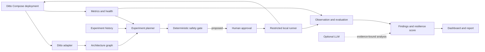

# Ditto AI Chaos Engineering

An AI-assisted resilience workbench for a deliberately isolated Eclipse Ditto deployment. The initial implementation has four coordinated specialists for deployment discovery, graph mapping, telemetry, and deterministic experiment planning, plus a loopback FastAPI and dashboard. It refuses to fabricate a Ditto topology when no manifest exists. Fault execution is deliberately disabled until Docker-backed approval, rollback, and recovery checks are implemented and verified.

## Why Ditto

Eclipse Ditto is an IoT digital-twin framework with five cooperating microservices and a locally runnable Docker Compose deployment. Its industrial IoT domain is relevant to Bosch, while its service boundaries and built-in metrics make it a useful resilience target. We keep Ditto upstream code in an ignored external checkout; this repository does not fork or patch it.

## Architecture



See [the architecture](docs/architecture.md) and [the full blueprint](docs/project-blueprint.md).
The upstream Ditto module paths and the custom workbench code map are in [Ditto codebase map](docs/ditto-codebase-map.md); the role-based 5-person breakdown and shared setup checklist are in [team implementation plan](docs/team-implementation-plan.md).

## Current Status

- Verified upstream target: [eclipse-ditto/ditto](https://github.com/eclipse-ditto/ditto), release `3.9.8` as checked on 2026-10-10.
- Local Ditto startup, benchmark dependencies, health/metrics endpoints, license, and architectural boundaries are documented in [Ditto integration](docs/ditto-integration.md).
- JSON Schemas and examples define shared data contracts in [schemas](schemas/); Compose and Kubernetes discovery, Prometheus normalization, local SQLite baseline history, deterministic ranking, FastAPI routes, and the local dashboard are implemented.
- The Docker chaos runner, live Ditto/Prometheus preflight, diagnosis agent, and public repository are not verified/available yet. The execute endpoint returns `503` by design. No root Compose file is included because this environment has no Docker and the target itself is a separate upstream deployment.
- No GitHub remote has been created, and nothing has been published.

## Prerequisites

- Windows 10/11 with PowerShell 7 recommended, Git, Docker Desktop with Docker Compose v2, and at least 2 CPU cores and 4 GB RAM available to Docker for the upstream single-instance Ditto setup.
- Python 3.12+ for repository checks.
- Node.js 18+ only if using Ditto's official Artillery load tool. Its documented benchmark setup also lists Kafka (with topic deletion enabled) and MMock; confirm the selected scenarios and required services during preflight.

## Local Setup

Create an isolated upstream checkout. It is ignored by this repository and pinned to the release inspected for this blueprint:

```powershell
New-Item -ItemType Directory -Force .local | Out-Null
git clone --branch 3.9.8 --depth 1 https://github.com/eclipse-ditto/ditto.git .local/ditto-upstream
Set-Content .local/ditto-runtime.env 'DITTO_VERSION=3.9.8'
docker compose --project-directory .local/ditto-upstream/deployment/docker --env-file .local/ditto-runtime.env -f .local/ditto-upstream/deployment/docker/docker-compose.yml up -d
```

Keep the upstream sample deployment local and private. Review its sample authentication and DevOps settings before use; do not expose ports beyond loopback or reuse its sample credentials. Stop it with:

```powershell
docker compose --project-directory .local/ditto-upstream/deployment/docker --env-file .local/ditto-runtime.env -f .local/ditto-upstream/deployment/docker/docker-compose.yml down
```

Validate this repository's contracts:

```powershell
py -3.12 -m venv .venv
.\.venv\Scripts\Activate.ps1
python -m pip install -r requirements-dev.txt
python -m unittest discover -s tests -v
```

Run the workbench locally on loopback (the target and Prometheus can remain unavailable; discovery will report that honestly):

```powershell
python -m pip install -r requirements-dev.txt
python -m uvicorn app.main:app --app-dir backend --host 127.0.0.1 --port 8000
```

Open `http://127.0.0.1:8000`. Set `DITTO_COMPOSE_FILE` to the upstream Compose file and `PROMETHEUS_URL` to a loopback Prometheus instance once those are configured. Never bind this workbench to `0.0.0.0`.

See [deployment instructions](docs/deployment.md) for version and telemetry caveats.

## Demo Workflow (Planned)

1. Start the pinned local Ditto stack and a low, bounded workload.
2. Capture a healthy baseline and build a confidence-labelled graph from the checked-out Compose file and official architecture facts.
3. Ask the planner for a candidate; show its target, hypothesis, graph evidence, predicted impact, uncertainty, and risk.
4. Require a named human approval. Execute only the allow-listed short container restart in the local Compose project.
5. Verify `/alive` and a functional Ditto canary, compare telemetry with the baseline, and produce an evidence-linked finding and score.

The planned flow is detailed in [the demo runbook](docs/hackathon-demo.md). Until the runner exists, do not interpret the configuration examples as executable fault injection.

## Team Workflow

Start with [CONTRIBUTING.md](CONTRIBUTING.md), use the issue forms under `.github/ISSUE_TEMPLATE/`, and make pull requests using `.github/pull_request_template.md`. Work is divided by module ownership and acceptance criteria in [the project blueprint](docs/project-blueprint.md). Do not commit `.env` files, credentials, private logs, Ditto data, or the external upstream checkout.

## License and Authorization

Original project files use the MIT License; Eclipse Ditto remains separately licensed under EPL-2.0. Confirm Bosch hackathon and employer IP/publication rules before public release. Use this tool only on systems you own or are explicitly authorized to test. See [SECURITY.md](SECURITY.md).