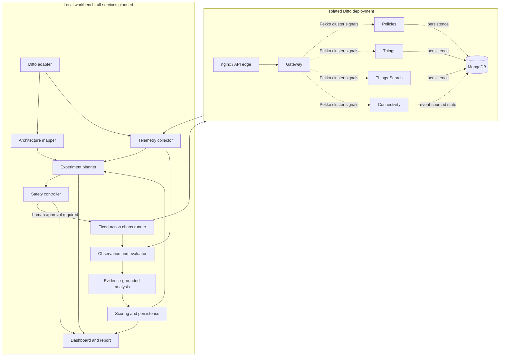

# System Architecture

## Logical View

The target-side dashed relationships are architecture-level facts from Ditto documentation, not claims that every request traverses every edge. The API edge is nginx in the example Docker deployment; the Gateway owns the public HTTP/WebSocket API. Ditto services communicate asynchronously in a Pekko cluster over TCP using serialized signals. MongoDB is persistence, not an internal service bus.

## Responsibilities and Interfaces

| Component | Owns | Interface / boundary |
| --- | --- | --- |
| Ditto adapter | Pinned deployment identity, read-only service facts, HTTP canary, health and metrics endpoint descriptors | `DittoDeployment` and normalized service records; no control-plane writes during discovery |
| Architecture mapper | Nodes, typed edges, provenance, confidence, discovery timestamps | Versioned graph; Compose `depends_on` is not treated as runtime call evidence |
| Telemetry collector | Health samples, Prometheus queries, workload metrics, phase/time windows | Normalized `Observation`; read-only endpoints |
| Experiment planner | Fixed candidate catalog, expected value, prediction, evidence references | Emits `Experiment` records only; no Docker client or shell access |
| Safety controller | Scope, target/action allow-list, risk/duration/concurrency limits, baseline health, approval freshness | Deterministic allow/deny decision plus reason; cannot be overridden by model output |
| Chaos execution engine | One fixed operation on an allow-listed service in the verified local Compose project | `execute_approved(experiment_id)`; private local runner, not reachable from model; cleanup in `finally` plus explicit recovery checks |
| Observation/evaluation | Before/during/after windows, prediction-vs-result, abort and recovery criteria | `ExperimentRun` and metric references |
| AI analysis | Hypothesis ranking and remediation wording grounded in supplied telemetry/topology | Structured output with evidence IDs and confidence; no commands, secrets, or execution tools |
| Resilience scoring | Versioned formula and missing-data policy | Recomputable score plus component scores and coverage; safety violations block a score |
| Dashboard/report | Graph, plans, approval, run state, score and evidence | Local-only API client; approval is an explicit user action |
| Persistence | Experiments, approvals, runs, evidence references, findings and score version | SQLite repository; Prometheus retains time series; raw logs excluded by default |

## Data Flow

1. Read the pinned Compose manifest and static Ditto docs; construct nodes/edges with source and confidence.
2. Probe local health and scrape/query the configured metrics endpoints. Verify API canaries with a separate bounded load generator.
3. Capture a healthy baseline and attach workload, version, graph, and metric coverage to it.
4. Generate candidates from a fixed experiment catalog, graph coverage, baseline, uncertainty, and experiment history.
5. Apply deterministic policy, show a typed proposal and predictions, and wait for a human approval.
6. Execute the fixed action, observe during and after, restore target if needed, and verify functional recovery.
7. Compare prediction and observation; persist reproducible metrics/findings, optionally request an LLM explanation, and render a report.

## Graph Evidence and Limits

Seed topology from the upstream Compose manifest and official architecture documents. The docs establish the five Ditto service roles, Pekko cluster communications, Mongo-backed persistence, and the gateway/API boundary. Compose exposes service dependencies and network membership, but neither alone proves a request path. Use metric labels and optional OpenTelemetry spans to add runtime evidence only when enabled and correlated; report such edges as inferred. Default tracing is disabled. Do not infer application dependencies from container names or coincident latency alone.

## Process and Trust Boundaries

The API/planner/LLM process must not receive Docker socket access or arbitrary command execution. The separately launched local runner accepts only a persisted approved experiment ID and resolves it through a hard-coded mapping of permitted service names to Compose actions. Bind APIs and telemetry ports to loopback. The optional LLM receives redacted, bounded, structured evidence and returns schema-validated text/hypotheses; it cannot approve, change policy, access secrets, or invoke tools.